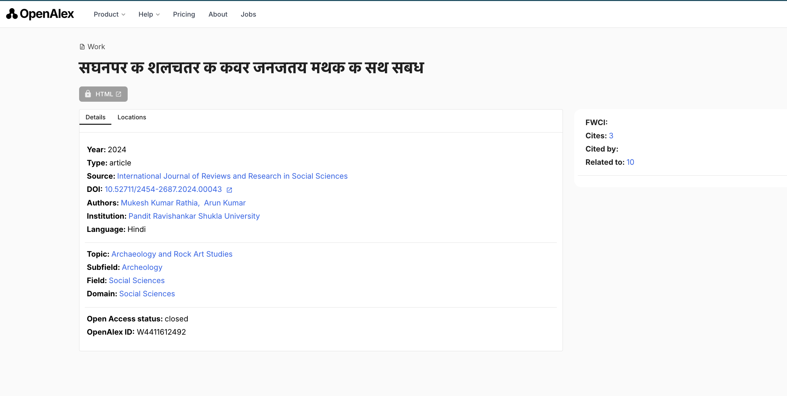

# Stripped vowel signs in OpenAlex titles

OpenAlex deletes vowel signs and similar marks from work titles in its last step before publishing. Titles in Hindi, Thai, Bengali, Tamil and other scripts reach the API, the website and the snapshot with those marks missing. These titles become hard to read, and keyword search cannot match them. Pasting a real title into `search=` found the work 5 times out of 48 in those four languages, against 47 of 48 in Korean, Russian, Chinese and English.

The fix looks small: one change to one pattern, in three places.

Measured on 2026-10-30. Code links point to [openalex-walden at 8f0d0cd](https://github.com/ourresearch/openalex-walden/tree/8f0d0cd9160fa455f8c45c255214ff6e5cdad2a1).

## What it looks like

| Work | Title from the publisher | Title in OpenAlex |
|---|---|---|
| [Hindi](https://openalex.org/W4411612492) | सिंघनपुर के शैलचित्र का कंवर जनजातीय मिथक के साथ संबंध | सघनपर क शलचतर क कवर जनजतय मथक क सथ सबध |
| [Thai](https://openalex.org/W4408653826) | การจำลองการทำงานของเครื่องกลึงซีเอ็นซีบนคอมพิวเตอร์ | การจำลองการทำงานของเครองกลงซเอนซบนคอมพวเตอร |
| [Bengali](https://openalex.org/W4413458185) | নারীবাদ প্রসঙ্গ | নরবদ পরসঙগ |
| [Tamil](https://openalex.org/W7155513791) | தமிழ் இலக்கியங்களில் வாழ்வியல் | தமழ இலககயஙகளல வழவயல |

The website shows the same damage. This is the Hindi work above on openalex.org:



## What it does to search

I searched titles for 19 common words in 11 languages, spelled correctly. Every search returned zero. The same words with their marks removed returned results.

| Language | Word | Title hits, correct spelling | Title hits, marks removed |
|---|---|---|---|
| Hindi | शिक्षा | 0 | 2,630 |
| Marathi | शिक्षण | 0 | 735 |
| Tamil | தமிழ் | 0 | 360 |
| Thai | การศึกษา | 0 | 160 |
| Bengali | বাংলাদেশ | 0 | 124 |
| Gujarati | શિક્ષણ | 0 | 62 |
| Kannada | ಶಿಕ್ಷಣ | 0 | 14 |
| Sinhala | අධ්යාපන | 0 | 13 |
| Punjabi | ਸਿੱਖਿਆ | 0 | 6 |
| Malayalam | വിദ്യാഭ്യാസം | 0 | 2 |
| Telugu | విద్య | 0 | 1 |

All 19 words are in [results/spelling_test.csv](results/spelling_test.csv).

Two controls show that the marks are the cause:

- **Same scripts, words with no marks:** these search normally. Thai ประเทศไทย returns 3,113 and Hindi नगर returns 226.
- **Other scripts:** Arabic التعليم returns 20,043, Korean 교육 returns 15,371 and Russian образование returns 13,016.

### Pasting a real title

This test takes the correct title from Crossref, searches OpenAlex for it, and checks whether the work appears in the top 25 results.

| Language | Titles tested | Damaged in OpenAlex | `search=` | `title.search` | Semantic search |
|---|---|---|---|---|---|
| Hindi | 12 | 12 | 3 | 0 | 11 |
| Thai | 12 | 12 | 0 | 0 | 11 |
| Bengali | 12 | 12 | 1 | 0 | 7 |
| Tamil | 12 | 12 | 1 | 0 | 9 |
| Arabic | 12 | 3 | 10 | 9 | not run |
| Korean | 12 | 0 | 12 | 12 | not run |
| Russian | 12 | 0 | 12 | 12 | not run |
| Chinese | 12 | 0 | 12 | 12 | not run |
| English | 12 | 0 | 11 | 12 | not run |

Across Hindi, Thai, Bengali and Tamil, `search=` found 5 of 48 works and `title.search` found none. Across Korean, Russian, Chinese and English, they found 47 of 48 and 48 of 48. Arabic shows the same split inside one language: all 3 damaged titles failed `title.search`, and all 9 undamaged titles were found.

### Which routes are affected

I ran two of the words through every keyword route. The routes split cleanly:

| Route | शिक्षा, correct spelling | การศึกษา, correct spelling |
|---|---|---|
| `title.search` | 0 | 0 |
| `title.search.exact` | 0 | 0 |
| `display_name.search` | 0 | 0 |
| OQL `works where title has` | 0 | 0 |
| Autocomplete | 0 | 0 |
| `title_and_abstract.search` | 5,687 | 1,087 |
| `search=` | 5,904 | 1,265 |

The last two routes return results because abstracts keep their marks. They can only reach works through the abstract, so a title on its own still cannot be matched.

**Semantic search is the exception.** It found 38 of the 48 real titles above, so API users have one route that mostly works.

## Cause

`sanitize_name` removes every character outside this pattern:

```python
unwanted_chars_pattern = r"[^\p{L}\p{N}\p{P}\p{S}\p{Z}]"
```

The pattern keeps letters, numbers, punctuation, symbols and separators. Unicode files vowel signs, tone marks and viramas under Mark, `\p{M}`, so they are deleted. The function is applied to `title` and `display_name` in three places:

| Step | File |
|---|---|
| Search index | [notebooks/elastic/sync_works.ipynb](https://github.com/ourresearch/openalex-walden/blob/8f0d0cd9160fa455f8c45c255214ff6e5cdad2a1/notebooks/elastic/sync_works.ipynb) |
| Lakebase documents | [notebooks/lakebase/BuildLakebaseWorksDocs.py](https://github.com/ourresearch/openalex-walden/blob/8f0d0cd9160fa455f8c45c255214ff6e5cdad2a1/notebooks/lakebase/BuildLakebaseWorksDocs.py#L230-L235) |
| Snapshot | [notebooks/snapshot/export_works.ipynb](https://github.com/ourresearch/openalex-walden/blob/8f0d0cd9160fa455f8c45c255214ff6e5cdad2a1/notebooks/snapshot/export_works.ipynb) |

### Evidence for the cause

**Replay.** I ran a Python equivalent of `sanitize_name` on the Crossref titles of 135 works in nine languages. OpenAlex had changed 61 of those titles, and the function reproduced all 61 exactly. It also left the other 74 unchanged, as OpenAlex did. See [results/sanitize_replay.csv](results/sanitize_replay.csv).

**Snapshot files.** I read 133,805 records from three files in the 2026-10-14 snapshot. They hold 79 titles in these four scripts, and none has a single mark. On the same works, 38 abstracts kept their marks and all 40 author names in those scripts kept theirs. See [results/snapshot_check.txt](results/snapshot_check.txt).

## Status

The title damage is already recorded in [docs/ES_INDEX_REBUILD.md](https://github.com/ourresearch/openalex-walden/blob/8f0d0cd9160fa455f8c45c255214ff6e5cdad2a1/docs/ES_INDEX_REBUILD.md#L196), added on 2026-10-02 in [ae9282f](https://github.com/ourresearch/openalex-walden/commit/ae9282f0515f47d24775a30000dcbaa54a63432d). That note names the search index and Lakebase steps, counts 1,477,228 source titles with a combining mark, and ends "Needs its own job."

This report adds four things: the effect on keyword search, the snapshot step, the zero-width joiners below, and a test anyone can rerun. I found no public report of it in the OpenAlex GitHub issues or in a web search.

## Suggested fix

Add `\p{M}` in all three places, and keep the zero-width joiners too:

```python
unwanted_chars_pattern = r"[^\p{L}\p{M}\p{N}\p{P}\p{S}\p{Z}\x{200C}\x{200D}]"
```

The joiners U+200C and U+200D are format characters, so the current pattern deletes them as well. Persian spelling uses them, as do some Sinhala and Malayalam forms. In the same snapshot files, 121 works have a joiner in their abstract and no title has one. Four Persian test words gave the same title search counts with and without the joiner, so this part looks like a display problem.

`BuildLakebaseWorksDocs.py` already carries a [TODO](https://github.com/ourresearch/openalex-walden/blob/8f0d0cd9160fa455f8c45c255214ff6e5cdad2a1/notebooks/lakebase/BuildLakebaseWorksDocs.py#L22) to unify this transform with `sync_works` and `export_works`. Doing that here would stop the copies drifting apart.

**Rollout.** This part is my reading of the public docs, and I have not tested it. The damage happens at publish time, and the rebuild doc's count implies the upstream titles still hold their marks. If so, the fix will not change `updated_date`, and the same doc warns that catch-up by `updated_date` misses changes like that. The fix would then need one targeted re-send of works whose title has a mark. About 1.5M documents is around a minute of load at the rebuild's rate of roughly 25K documents a second. The next snapshot should pick the fix up.

**Keeping it fixed.** `IndexRebuild.py` still [skips its 500-query replay](https://github.com/ourresearch/openalex-walden/blob/8f0d0cd9160fa455f8c45c255214ff6e5cdad2a1/notebooks/elastic/IndexRebuild.py#L803-L806) because the query set does not exist yet. The words in the spelling test could be a first slice of that set, with a rule that correctly spelled common words must never return zero. A Guardrails check could also compare published titles with the upstream text, in the same way check 10 catches garbled affiliation strings.

## Reproduce

```
OPENALEX_API_KEY=your_key python3 reproduce.py
python3 snapshot_check.py
```

Both use the Python standard library only. `reproduce.py` costs about $0.35 of the free $1.00 daily budget and writes the CSV files in `results/`. `snapshot_check.py` needs no key and downloads about 210 MB.

## Limits

- The real-title test uses 12 works per language and the replay uses 15. Both are small random samples with fixed seeds, limited to works that have a DOI and a Crossref title.
- Results can shift as the index changes.
- For Hindi, Thai, Bengali and Tamil, the real-title test only picked titles with at least one mark.
- I picked the 19 test words by hand. Telugu and Malayalam have very few hits either way.
- The Sinhala test word leaves out the zero-width joiner that its standard form uses.
- Burmese, Khmer and Lao words returned zero both ways, so I drew no conclusion for those languages.
- On the website I checked the displayed title of one work by hand. I did not test website search.
- `sanitize_name` here is a Python equivalent. I did not run Spark's regular expression engine, including on the suggested pattern.
- The figure of 1,477,228 comes from the OpenAlex doc. I did not measure it.
- The snapshot check reads part of three files out of 1,898.
